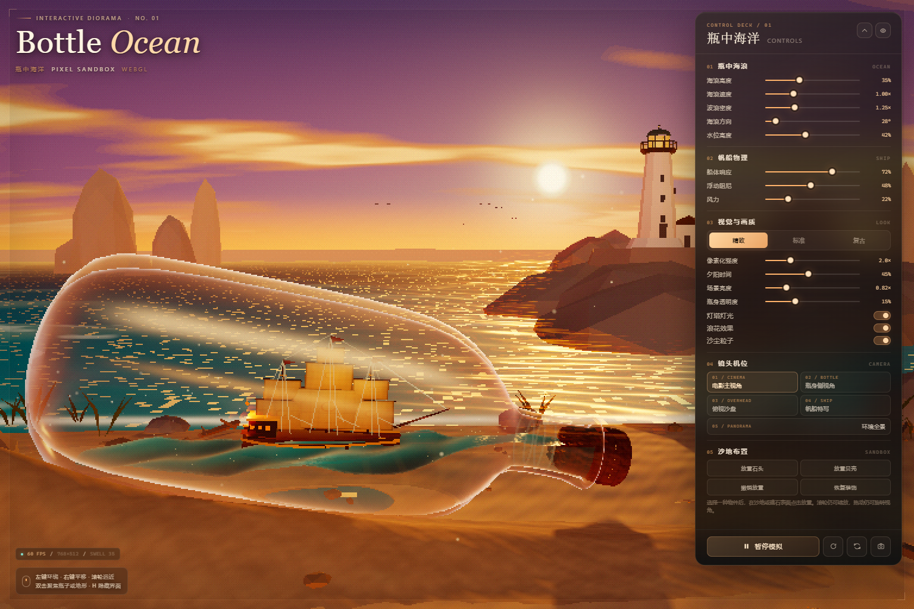

# Beach-Bottle-Boat · 瓶中海洋

**一个可离线运行的单文件 Three.js 交互式 3D 像素微缩景观。**

黄昏海岸上，一只斜躺在沙滩中的玻璃瓶，装着一整片会起伏的微型海洋和一艘三桅帆船。拖动镜头、调高海浪，就能看到波浪真实地托起帆船——不是贴图，也不是两段独立动画。



## 在线体验

开启 GitHub Pages 后，可直接访问：

**https://banagher-001.github.io/Beach-Bottle-Boat/**

> 仓库的 `index.html` 与 `bottle_ocean_sandbox.html` 是完全相同、可离线运行的单文件成品。

### 启用 GitHub Pages

1. 打开本仓库 **Settings → Pages**
2. **Build and deployment → Source** 选择 **Deploy from a branch**
3. Branch 选择 **main**，目录选择 **/(root)**，保存
4. 等待约 1 分钟，访问上述地址

## 直接打开

- 双击仓库根目录的 **index.html** 或 **bottle_ocean_sandbox.html**
- 或启动任意静态服务器：

```bash
python -m http.server 8123
# http://127.0.0.1:8123/
```

无需安装依赖、无需联网。Three.js、全部着色器、几何体、纹理、UI 均已内联在这一个 HTML 文件中。

## 核心功能

### 玻璃瓶与瓶中海洋
- 程序化 Lathe 玻璃瓶：规则瓶身轮廓、真实内外壁厚、瓶口凸缘、软木塞、颈部环纹
- 世界水平面波浪 + 解析瓶腔裁剪：水面不会穿出玻璃
- 瓶内独立水体、蓝绿渐变、泡沫、日光反射、体积水色
- 三桅木质帆船：船体、甲板、桅杆、风帆、索具、旗帜、船窗、艉灯

### 海浪 → 帆船物理联动
- 统一解析波浪场：CPU 船体采样与 GPU 水面渲染使用同一组波参数、同一时间、同一坐标系
- 船首、船尾、左舷、右舷、中心五采样点
- 带阻尼弹簧动力学：浮沉、俯仰、横摇具有惯性与重量感
- 船体姿态受海浪高度、速度、密度、方向实时驱动
- 桅顶/船壳/船体安全边界实时校验，强浪不穿模

### 外部世界
- 程序化高度场沙地、干湿沙过渡、沙丘、风纹
- 独立外部海洋：深蓝/青绿层次、夕阳金色反光路径、近岸浪花
- 黄昏天空：渐变、像素云层、太阳光晕、空气透视
- 3D 海岸悬崖、礁石、海蚀柱
- 3D 灯塔：塔身、灯室、附属小屋、暖色灯、可开关 + 可点击
- 贝壳、卵石、海草、漂流木、沙尘与浪花粒子
- 环境贴图、方向光、半球光、雾效统一照明

### 像素渲染
- 离屏低分辨率渲染 + Nearest Neighbor 放大
- 三档画质：精致像素 / 标准像素 / 复古像素
- Bayer 4×4 抖动、色阶量化、暗角、Bloom、ACES 色调映射
- UI 不受像素化影响

### 相机与控制
- OrbitControls：左键环绕、右键平移、滚轮缩放
- 双击瓶子聚焦 / 双击地形切换观察中心
- 5 个平滑插值镜头预设：电影主视角、瓶身侧视、俯视沙盘、帆船特写、环境全景
- 相机与地形安全边界约束

### UI / 交互
- 玻璃拟态深色控制面板，桌面右侧 / 移动端可折叠
- 海洋参数：海浪高度、速度、密度、方向、水位
- 船体参数：船体响应、浮动阻尼、风力
- 视觉参数：画质、像素化强度、夕阳时间、亮度、瓶身透明度、灯塔/浪花/沙尘开关
- 播放控制：暂停/继续、重置参数、恢复镜头、保存截图、隐藏 UI
- 沙盒编辑：在沙地放置石头/贝壳、撤销、恢复装饰
- 保存截图输出 1920×1080 PNG（保留像素化外观）

## 操作速查

| 操作 | 行为 |
|---|---|
| 左键拖动 | 环绕观察 |
| 右键拖动 | 平移 |
| 滚轮 | 推近 / 拉远 |
| 双击瓶子/船 | 聚焦瓶身 |
| 双击沙地 | 切换观察中心 |
| H | 隐藏 / 显示界面 |
| Esc | 退出沙盒放置模式 |
| 右侧「镜头机位」 | 5 个电影镜头 |

## 工程结构

```text
index.html / bottle_ocean_sandbox.html   单文件成品（内容相同）
src/
  world.js        程序化黄昏海岸、海洋、天空、灯塔、粒子
  bottle.js       玻璃瓶、瓶腔解析约束、玻璃着色器
  waves.js        统一波浪模型（CPU/GPU 共用）
  water.js        瓶内水面、体积水体、泡沫
  boat.js         三桅帆船 + 浮力/摇摆物理
  post.js         像素化后处理、Bloom、色调映射
  camera.js       OrbitControls + 镜头预设
  ui.js           控制面板交互
  main.js         场景编排、状态、沙盒、截图
  index.template.html
build.mjs         esbuild 单文件构建
package.json
tools/qa.mjs      Playwright 浏览器自动化 QA
tools/serve.mjs   零依赖本地静态服务器
screenshots/      交付截图
qa-shots/         关键 QA 证据 + raw results
QA_REPORT.md      独立浏览器验收报告
```

## 开发与构建

需要 Node.js 18+ 和 pnpm：

```bash
pnpm install
pnpm build     # 生成 bottle_ocean_sandbox.html 与 index.html
pnpm serve     # 本地预览 http://127.0.0.1:8123
pnpm qa        # 运行 Playwright 浏览器验收（需 Chrome）
```

`pnpm build` 会把 Three.js 和所有源码打包进一个自包含 HTML。

## 浏览器验收

QA 报告：[QA_REPORT.md](QA_REPORT.md)

- 83 项检查：**81 PASS + 2 INFO，0 FAIL，0 WARN**
- A–H 全部 PASS：离线加载、渲染完整性、海浪→船体联动、波浪方向、相机、交互、性能、响应式
- 文件与 HTTP 双通道冷启动，无外部网络请求、无 console/pageerror
- 1920×1080 硬件 WebGL2（RTX 3060）三档画质约 60 FPS
- 海况响应：升沉 / 俯仰 / 横摇振幅随 0% → 50% → 100% 单调增强
- 暂停冻结 simTime 与船体姿态；继续首帧位置/旋转零跳变；船腔安全校验 100% 通过
- 关键证据位于 [qa-shots/](qa-shots/)

## 已知限制

- 玻璃使用定制 Fresnel/反射近似而非屏幕空间真实折射，以保证低多边形像素画风与稳定渲染
- 船体浮力为五采样 + 弹簧阻尼近似，不是完整 CFD
- 外部海洋独立于瓶内海浪，不随内部参数联动
- 截图仅包含 WebGL 场景画面，不包含 DOM 控制面板
- 纯软件渲染（SwiftShader）下帧率会明显降低；实际桌面 GPU 目标 60 FPS

## 第三方与许可

- [Three.js](https://threejs.org/) — MIT，版权归 three.js authors
- 构建工具 esbuild — MIT
- Playwright Core — Apache-2.0
- 本仓库所包含的网站源代码与美术资源由作者创作

详见 [THIRD_PARTY_NOTICES.md](THIRD_PARTY_NOTICES.md)。

---

**Bottle Ocean** — a tiny ocean, a small ship, one warm evening.
